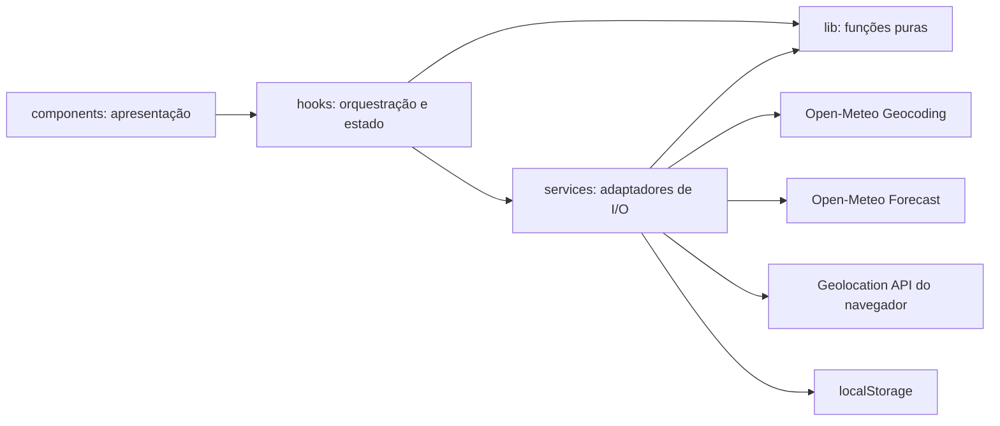

# Plano Técnico — Weather App

Este plano deriva de [`specs/weather-app-spec.md`](../specs/weather-app-spec.md). Ele define arquitetura, decisões e contratos para orientar as tarefas de implementação; não é código de produção.

## Architecture

Aplicação cliente React com dependências direcionadas da apresentação para a orquestração, e desta para os adaptadores externos. `components` renderiza dados e encaminha ações; `hooks` coordena o fluxo de busca, seleção, consulta, atualização e preferências; `services` encapsula I/O e converte respostas externas em modelos internos; `lib` contém cálculos e transformações puras. Componentes não chamam APIs nem acessam armazenamento diretamente.



O hook mantém as transições de estado e seleciona qual service chamar; services recebem parâmetros explícitos e retornam modelos tipados ou erros classificados. `lib` não depende de React, navegador ou rede. Tipos compartilhados documentam os contratos entre essas camadas.

A localização automática requer reverse geocoding para transformar coordenadas em cidade, mas a API de geocoding da Open-Meteo oferece busca por nome, não busca reversa. Para cumprir AC-FR01-01 e identificar o nome, a implementação precisará de um serviço de reverse geocoding externo. Isso deve ser decidido antes da implementação: avaliar um provedor compatível com uso sem chave (por exemplo, Nominatim), seus limites e termos; informar o compartilhamento de coordenadas. Se essa dependência não for aprovada, a alternativa simples é consultar o clima pelas coordenadas e identificar o local como “Minha localização”, o que não atende integralmente ao critério de identificar a cidade.

## Tech Stack

| Tecnologia | Uso e justificativa |
| --- | --- |
| TypeScript strict | Contratos explícitos para respostas externas e estados da UI. |
| React + Vite | Stack definida pelo projeto; componentes e desenvolvimento local. |
| Tailwind CSS | Estilização conforme a stack e o tema do projeto. |
| Fetch API + AbortController | Integração HTTP sem dependência adicional e timeout/cancelamento de requisições. |
| Vitest + Testing Library | Testes unitários e de componentes conforme a stack existente. |
| Playwright | Fluxos E2E e validação responsiva/acessível nos viewports definidos. |
| localStorage | Persistência local da unidade e da lista de cidades recentes, com falha tratada como não fatal. |

Não adicionar gerenciamento global de estado nem biblioteca de data-fetching: o escopo pode ser coordenado por um hook e services simples.

## Project Structure

```text
src/
  components/
    CitySearch.tsx       # Entrada, resultados e estado vazio da busca
    CurrentWeather.tsx   # Condições atuais e campos indisponíveis
    ForecastList.tsx     # Cinco resumos diários
    WeatherControls.tsx  # Unidade, atualizar e cidades recentes
    StatusMessage.tsx    # Loading e mensagens de erro acessíveis
  hooks/
    useWeatherApp.ts     # Estado e coordenação dos fluxos da aplicação
  services/
    geocoding.ts         # Busca e normalização de cidades
    weather.ts           # Request, timeout e mapeamento do forecast
    location.ts          # Adaptador da Geolocation API
    storage.ts           # Persistência local best-effort
  lib/
    temperature.ts       # Conversão e arredondamento de temperaturas
    weatherCode.ts       # Mapeamento de códigos WMO para rótulos pt-BR
    date.ts              # Datas e tempo relativo no fuso selecionado
  types/
    weather.ts           # City, CurrentWeather, ForecastDay, WeatherData e Unit
```

Os componentes recebem dados e callbacks por props. `useWeatherApp` expõe estado e operações para a tela, sem conter detalhes de URL ou JSON do provedor. Cada service valida os dados externos e os mapeia para tipos internos; `storage` limita persistência à unidade e aos metadados das cinco cidades recentes, sem coordenadas. As funções de `lib` são determinísticas e não fazem I/O.

Essa divisão torna os testes focados: `lib` é verificado com entradas e saídas diretas; services são testados com `fetch` e APIs do navegador mockados; o hook é testado substituindo os services para verificar transições, retry e persistência; componentes são testados por props, interação e acessibilidade, sem rede. Playwright cobre os fluxos integrados reais no navegador e viewports exigidos pela spec.

## Data Model

Os modelos internos devem representar ausência de dados sem inventar valores. Coordenadas pertencem à cidade ativa em memória e não devem ser incluídas nos registros persistidos de recentes.

```ts
// Unidade usada apenas na apresentação das temperaturas.
type Unit = 'celsius' | 'fahrenheit';

interface City {
  id: string;                 // Identificador estável do resultado do geocoding
  name: string;               // Nome da cidade retornado pelo geocoding
  admin1?: string;            // Região administrativa, como estado
  country?: string;           // País da cidade
  latitude: number;           // Latitude usada na consulta meteorológica
  longitude: number;          // Longitude usada na consulta meteorológica
  timezone?: string;          // Fuso IANA retornado pelo geocoding
}

interface CurrentWeather {
  time: string;                       // Horário da observação em formato ISO
  temperatureC: number | null;        // Open-Meteo: current.temperature_2m
  apparentTemperatureC: number | null;// Open-Meteo: current.apparent_temperature
  weatherCode: number | null;         // current.weather_code, código WMO
  windSpeedKmh: number | null;        // current.wind_speed_10m em km/h
  relativeHumidityPercent: number | null; // current.relative_humidity_2m em %
  precipitationPreviousHourMm: number | null; // current.precipitation em mm
}

interface ForecastDay {
  date: string;                       // daily.time no fuso selecionado, YYYY-MM-DD
  weatherCode: number | null;         // daily.weather_code, código WMO
  temperatureMinC: number | null;     // daily.temperature_2m_min em Celsius
  temperatureMaxC: number | null;     // daily.temperature_2m_max em Celsius
  precipitationSumMm: number | null;  // daily.precipitation_sum em mm
}

interface WeatherData {
  city: City;                         // Cidade selecionada para esta consulta
  current: CurrentWeather;            // Condições atuais mapeadas do provedor
  forecast: ForecastDay[];            // Cinco dias, com dados ausentes indicados como null
  receivedAt: number;                 // Instante de sucesso em epoch milliseconds
}

interface RecentCity {
  id: string;                 // Identificador para resolver a cidade novamente
  name: string;               // Nome exibido na lista de recentes
  admin1?: string;            // Região administrativa, quando disponível
  country?: string;           // País, quando disponível
}
```

As respostas externas devem ter tipos próprios mínimos e ser validadas no limite do service. A conversão para Fahrenheit é derivada na apresentação: `F = C * 9 / 5 + 32`, arredondando apenas o valor exibido a uma casa decimal; os valores armazenados no modelo permanecem em Celsius. Vento, umidade e precipitação não são convertidos.

## Data Flow

1. Na inicialização, carregar unidade e recentes do armazenamento local, sem bloquear a busca. Iniciar geolocalização em paralelo com a disponibilidade da busca manual; encerrar a tentativa em 10 segundos.
2. Na busca manual, aplicar `trim`; se vazio, mostrar validação local e não chamar a API. Caso contrário, chamar geocoding, preservar Unicode e apresentar cidade, região e país disponíveis.
3. Ao selecionar resultado, manter a cidade ativa em memória e consultar forecast pelas coordenadas. Selecionar um recente inicia nova resolução geográfica por seu identificador/nome, pois coordenadas não são persistidas.
4. No sucesso, mapear campos, atualizar `receivedAt`, mover a cidade ao início dos recentes (deduplicar e limitar a cinco) e renderizar condições e cinco dias. Somente consultas meteorológicas bem-sucedidas entram em recentes.
5. Ao atualizar ou tentar novamente, reutilizar a cidade ativa e repetir a consulta sem exigir nova digitação. Falha não altera `receivedAt` nem os recentes.
6. Alternar unidade apenas atualiza preferência e renderização; não faz nova chamada meteorológica.

Para a previsão, solicitar ao provedor datas no fuso do dispositivo detectado (`Intl.DateTimeFormat().resolvedOptions().timeZone`), com `America/Sao_Paulo` como fallback. Isso mantém o conjunto “hoje + quatro dias” alinhado ao critério AC-FR04-03, mesmo quando a cidade consultada está em outro fuso.

## External APIs

### Geocoding — busca manual

- URL-base: `https://geocoding-api.open-meteo.com/v1/search`
- Exemplo de URL para uma busca aparada por “São Paulo”:

```text
https://geocoding-api.open-meteo.com/v1/search?name=S%C3%A3o%20Paulo&count=10&language=pt&format=json
```

- Parâmetros: `name` é obrigatório e recebe o termo após `trim` (codificado como UTF-8); `count` limita resultados; `language=pt` solicita nomes em português; `format=json` seleciona JSON.
- Mapeamento de cada `results[]` para `City`: converter `id` numérico em string para `City.id`; mapear `name`, `admin1`, `country`, `latitude`, `longitude` e `timezone` para os campos homônimos. `admin1`, `country` e `timezone` podem estar ausentes. As coordenadas são mantidas somente para a cidade ativa em memória.
- Resposta resumida:

```json
{
  "results": [{
    "id": 3448439,
    "name": "São Paulo",
    "admin1": "São Paulo",
    "country": "Brasil",
    "latitude": -23.55,
    "longitude": -46.63,
    "timezone": "America/Sao_Paulo"
  }]
}
```

`results` ausente ou vazio representa busca sem correspondência (`empty`); falha HTTP, timeout ou resposta inválida representa erro. O service valida os tipos recebidos antes de criar `City`.

### Forecast — atual e diário

- URL-base: `https://api.open-meteo.com/v1/forecast`
- Exemplo de URL para São Paulo. Substituir coordenadas pelas da `City` ativa e o fuso pelo identificado no dispositivo (ou fallback indicado):

```text
https://api.open-meteo.com/v1/forecast?latitude=-23.55&longitude=-46.63&current=temperature_2m,apparent_temperature,weather_code,wind_speed_10m,relative_humidity_2m,precipitation&daily=weather_code,temperature_2m_max,temperature_2m_min,precipitation_sum&forecast_days=5&timezone=America%2FSao_Paulo&temperature_unit=celsius&wind_speed_unit=kmh&precipitation_unit=mm
```

- Parâmetros: `latitude` e `longitude` vêm da cidade selecionada; `current` solicita condição, temperatura, sensação térmica, vento, umidade e precipitação horária; `daily` solicita código, máximas, mínimas e precipitação acumulada; `forecast_days=5` solicita hoje e os quatro dias seguintes; `timezone` recebe o fuso do dispositivo ou `America/Sao_Paulo`; as opções de unidade mantêm o modelo normalizado em Celsius, km/h e mm.
- Mapeamento para `CurrentWeather`: `current.time` → `time`; `temperature_2m` → `temperatureC`; `apparent_temperature` → `apparentTemperatureC`; `weather_code` → `weatherCode`; `wind_speed_10m` → `windSpeedKmh`; `relative_humidity_2m` → `relativeHumidityPercent`; `precipitation` → `precipitationPreviousHourMm`.
- Mapeamento para `ForecastDay`: para cada índice `i` de `daily.time`, criar um item com `time[i]` → `date`, `weather_code[i]` → `weatherCode`, `temperature_2m_min[i]` → `temperatureMinC`, `temperature_2m_max[i]` → `temperatureMaxC` e `precipitation_sum[i]` → `precipitationSumMm`. Mapear os valores finitos; para campo ausente/inválido usar `null`, e manter até cinco dias na ordem retornada.
- Resposta resumida (o retorno real contém os cinco elementos diários):

```json
{
  "current": {
    "time": "2026-11-05T12:00",
    "temperature_2m": 20.0,
    "apparent_temperature": 19.2,
    "weather_code": 3,
    "wind_speed_10m": 12.0,
    "relative_humidity_2m": 65,
    "precipitation": 0.4
  },
  "daily": {
    "time": ["2026-11-05", "2026-11-06", "2026-11-07", "2026-11-08", "2026-11-09"],
    "weather_code": [3, 2, 1, 3, 61],
    "temperature_2m_max": [24.0, 25.0, 26.0, 23.0, 21.0],
    "temperature_2m_min": [16.0, 17.0, 18.0, 15.0, 14.0],
    "precipitation_sum": [1.2, 0.0, 0.0, 2.4, 5.1]
  }
}
```

O `weather_code` WMO é traduzido para condição em pt-BR por uma tabela local; os números não são rótulos para exibição. A precipitação atual é o acumulado horário reportado pelo campo `current.precipitation`; o resumo diário usa `daily.precipitation_sum`. O retorno de `forecast` não contém os metadados da cidade, então `WeatherData.city` vem da `City` selecionada; `WeatherData.receivedAt` é definido pelo app no recebimento bem-sucedido.

### Geolocalização e reverse geocoding

`navigator.geolocation` fornece latitude/longitude após consentimento; não é uma API de clima. A conversão dessas coordenadas em nome de cidade não existe no endpoint de busca da Open-Meteo. Um endpoint de reverse geocoding só deve ser escolhido após avaliar política de uso, disponibilidade, CORS e a informação de privacidade apresentada à pessoa usuária. Não persistir coordenadas em armazenamento local.

## State Management

Um hook `useWeatherApp` mantém estado local da experiência. Separar estado de busca do estado meteorológico para que a busca permaneça utilizável durante a localização e durante falhas de consulta.

```ts
type AsyncState<T> =
  | { status: 'idle' }
  | { status: 'loading' }
  | { status: 'success'; data: T }
  | { status: 'empty' }
  | { status: 'error'; kind: 'offline' | 'timeout' | 'service' | 'invalid'; message: string };

interface WeatherAppState {
  query: string;
  search: AsyncState<City[]>;
  weather: AsyncState<WeatherData>;
  activeCity: City | null;
  unit: Unit;
  recentCities: RecentCity[];
  locationStatus: 'idle' | 'loading' | 'success' | 'denied' | 'timeout' | 'error';
}
```

`receivedAt` vive nos dados de sucesso e permanece inalterado quando uma atualização falha. A indicação relativa deve ser recalculada periodicamente na UI, sem novo request. Persistir somente `unit` e `RecentCity[]`; validar valores ao ler e tratar indisponibilidade/erro de `localStorage` como degradação não fatal.

## Error Handling

- Toda requisição HTTP usa `AbortController` com timeout de 10 segundos. Cancelar requisições obsoletas ao trocar de cidade ou iniciar busca nova, evitando que respostas antigas sobrescrevam a seleção atual.
- Estado `empty` representa busca sem resultados ou previsão/dados ausentes; não deve ser confundido com falha de rede.
- Falha de conectividade observável (`navigator.onLine === false`) apresenta “Você está sem internet”; falha HTTP, JSON inválido ou serviço indisponível apresenta “Não foi possível atualizar”. Timeout termina a solicitação e apresenta mensagem simples com ação de tentar novamente. Não depender apenas de `navigator.onLine` para classificar falha.
- Falha de geolocalização ou reverse geocoding mantém a busca manual disponível; permissão negada não bloqueia a aplicação.
- Campos atuais ausentes são exibidos individualmente como indisponíveis. Dias incompletos permanecem na lista de cinco, com os dados ausentes indicados como indisponíveis; nunca substituir ausências por zero.
- Feedback de carregamento aparece imediatamente. Em sucesso, manter o indicador visível por no mínimo dois segundos desde o início da requisição; erros são comunicados assim que detectados e não aguardam esse mínimo.
- Retry repete a operação correspondente usando termo ou cidade já mantidos no estado. Erros não apagam dados válidos anteriores nem atualizam o timestamp de sucesso.

## Testing Strategy

- Vitest para conversões Celsius/Fahrenheit e arredondamento; formatação de datas no fuso selecionado e fallback de Brasília; mapeamento de códigos WMO; normalização de termos e respostas parciais.
- Services com `fetch` mockado: parâmetros/endpoints, respostas válidas e vazias, HTTP inválido, JSON incompleto, timeout e cancelamento. Verificar que geocoding preserva Unicode.
- Testes de hook/componentes para localização negada/timeout, busca vazia e sem resultados, loading, sucesso, erros offline/serviço, retry sem redigitação, atualização sem alterar timestamp em falha, unidade persistida e dados parciais.
- Testes de armazenamento para unidade default Celsius, cidades recentes deduplicadas/limitadas a cinco, consulta bem-sucedida e indisponibilidade de `localStorage`; confirmar que coordenadas não são persistidas.
- Playwright para fluxos de busca e seleção, alternância de unidade, atualização/retry, recentes, localização concedida/negada e validação visual/funcional em 320 px e desktop. Verificar navegação por teclado, nomes acessíveis, foco e mensagens de estado; validar navegadores/plataformas suportados conforme NFR-11.

## Risks & Trade-offs

| Risco ou decisão | Escolha do plano | Trade-off / rastreabilidade |
| --- | --- | --- |
| Reverse geocoding automático | É uma dependência a decidir; não existe na API de busca da Open-Meteo. | Provedor adicional aumenta chamadas, dependência, latência e compartilhamento de coordenadas. Exibir “Minha localização” evita provedor, mas não satisfaz integralmente AC-FR01-01. |
| Recentes sem coordenadas persistidas | Salvar identificador e rótulos; resolver novamente ao selecionar. | Evita persistir coordenadas conforme NFR-05, mas requer geocoding adicional e pode falhar se a cidade deixar de ser resolvível. |
| Fuso da previsão | Enviar à API o fuso do dispositivo, com fallback Brasília. | Mantém as datas solicitadas pelo produto, embora os dias possam diferir do calendário local da cidade consultada (AC-FR04-03/04). |
| Dados parciais | Tipos anuláveis e indicação indisponível por campo/dia. | Mais tratamento na UI, mas preserva a precisão e atende AC-FR03-04 e AC-FR04-05. |
| Localização e privacidade | Solicitar permissão do navegador e informar o envio das coordenadas ao provedor necessário. Não armazená-las. | O fluxo automático depende de consentimento, disponibilidade do navegador e conectividade (NFR-04/05). |
| Sem cache meteorológico | Consultar sob demanda e em atualização manual. | Implementação simples e dados recentes; mais chamadas e dependência de disponibilidade do provedor. |
| Indicador mínimo de 2 s | Aplicar mínimo somente ao sucesso, mantendo erro imediato. | Pode atrasar a apresentação de respostas rápidas, mas atende NFR-03 sem ocultar falhas. |

Os contratos acima rastreiam principalmente FR-01 a FR-08 e NFR-01 a NFR-11; requisitos de interface e acessibilidade devem ser detalhados nas tarefas de UI e verificados nos testes de componente/E2E.